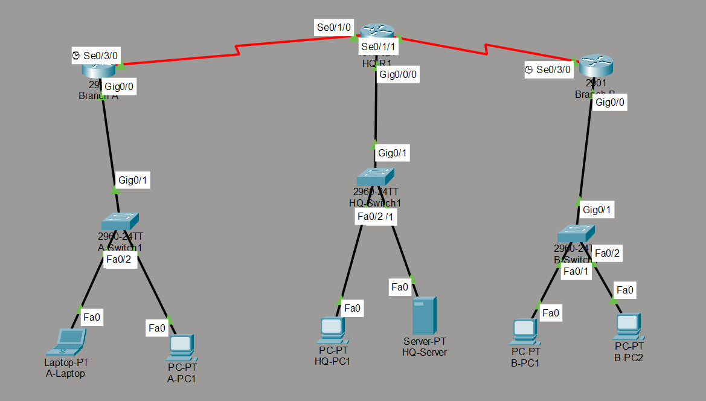

# 🌐 CCNA: Introduction to Networks — Packet Tracer Labs

Network project and completed Packet Tracer activities from the **Cisco Networking Academy CCNA: Introduction to Networks (ITN)** course, which I finished with a certificate.

## 🗺️ Final topology

Full project file: [`Cisco_packet_tracer_Serhat_Tay.pkt`](Cisco_packet_tracer_Serhat_Tay.pkt)

## 🧩 Topics covered
| Module | Activities |
|---|---|
| 1–2 · Networking basics & Cisco IOS | Logical/physical modes, IOS navigation, console access, initial switch configuration, basic connectivity |
| 4 · Physical layer | Wired & wireless LAN, physical layer cabling |
| 9 · Addressing | Identifying MAC and IP addresses |
| 10 · Router configuration | Initial router settings, connecting a router to a LAN, troubleshooting default gateways |
| 11 · IPv4 subnetting | Subnetting scenarios, VLSM design and implementation |
| 12–13 · IPv6 & ICMP | IPv6 addressing schemes, dual-stack verification, ping & traceroute troubleshooting |

## 📂 Files
| File | What it is |
|---|---|
| [`Cisco_packet_tracer_Serhat_Tay.pkt`](Cisco_packet_tracer_Serhat_Tay.pkt) | My final network project |
| [`Cisco_Diagram.png`](Cisco_Diagram.png) | Topology diagram of the final project |

The course activity files (`.pka`) belong to Cisco Networking Academy and are not redistributed here; the table above lists the modules I completed.

## ▶️ Open
Install [Cisco Packet Tracer](https://www.netacad.com/courses/packet-tracer) and open the `.pkt` file.
